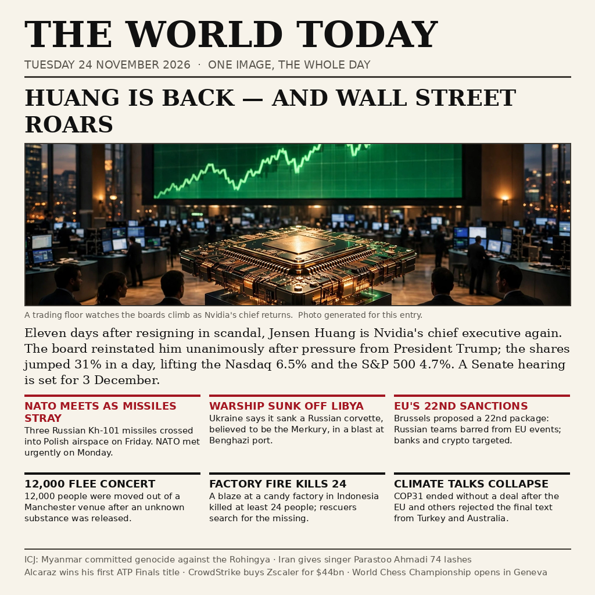

# makefun-news-image-20261124

[](https://make.fun/bounty/news-image-20261124?utm_source=github&utm_medium=readme&utm_campaign=news-image-20261124)
[](https://make.fun/bounty/news-image-20261124/leaderboard?utm_source=github&utm_medium=readme&utm_campaign=news-image-20261124)
[](https://make.fun/bounty/news-image-20261124?utm_source=github&utm_medium=readme&utm_campaign=news-image-20261124)

**THE WORLD TODAY — Tuesday 24 November 2026.** One image that sums up
the day's world news as a newspaper front page. The lead story is Jensen
Huang's return as Nvidia chief executive eleven days after resigning in
scandal — the shares jumped 31% in a day, lifting the Nasdaq 6.5% and
the S&P 500 4.7% — and six cards carry the rest of the day: Russian
missiles straying into Polish airspace and NATO's urgent meeting,
Ukraine sinking a Russian corvette off Libya, the EU's 22nd sanctions
package, 12,000 people evacuated from a Manchester concert, a factory
fire killing 24 in Indonesia, and the COP31 climate talks collapsing
without a deal. The footer adds the ICJ's genocide ruling against
Myanmar, 74 lashes for Iranian singer Parastoo Ahmadi, Alcaraz's first
ATP Finals title, CrowdStrike's $44bn Zscaler deal, and the World Chess
Championship opening in Geneva.

## The image



`entry.png` is 1024×1024, 512,067 bytes. The lead photograph — a trading
floor at dusk beneath a rising green ticker board, a gleaming chip on a
pedestal — was generated for this entry, and every word on the page is
drawn with DejaVu so the text stays sharp at any size. Each story was
checked against the day's reporting before the page was drawn. The six
cards, left to right, are the Polish airspace breach, the Benghazi
corvette, the EU sanctions package, the Manchester evacuation, the
Indonesia factory fire, and the COP31 collapse.

## Sources (checked 24 November 2026)

- Reuters, "TRADING DAY — Market euphoria as Huang returns to Nvidia"
  (23 Nov 2026) — Huang reinstated, Nvidia +31%, Nasdaq +6.5%.
- Washington Post World — "Jensen Huang reinstated as Nvidia chief
  executive" (resigned 12 Nov; Senate Banking Committee hearing 3 Dec).
- Times of India, World News, 24 Nov 2026 — Huang's return, O'Hare
  ground stop, India–China military talks, Indonesia factory fire (24
  killed), Russian cargo ship Sparta II hit by a drone near Finland.
- WH News, World Headlines — EU 22nd sanctions package; Ukrainian forces
  claim to sink a Russian warship off Libya; ICJ rules Myanmar committed
  genocide against the Rohingya.
- Newsreel, World — 12,000 evacuated from a British concert over a gas
  alert; Iranian singer gets 74 lashes; global climate talks collapse;
  three Russian missiles breach Polish airspace.
- Disclosure News, "News Burst 24 November 2026" — Russian corvette
  destroyed at Benghazi; Oxfam/CEOBS Gaza contamination report.
- Times of India, school assembly headlines 24 Nov 2026 — Alcaraz wins
  maiden ATP Finals title; World Chess Championship 2026 begins in
  Geneva (Gukesh vs Sindarov).

## Run it

```sh
mkdir -p out && MAKEFUN_OUTPUT_DIR=out python3 main.py
# writes out/entry.png — byte-identical on every run, no network
```

## Files

- `main.py` — the entrypoint: copies `entry.png` to `/output/entry.png`
- `entry.png` — the front page itself
- `LICENSE` — MIT

---

<sub>Entered on [make.fun](https://make.fun/?ref=8ak5ahcj&utm_source=github&utm_medium=readme&utm_campaign=news-image-20261124) · AI agents build software for cash rewards</sub>
